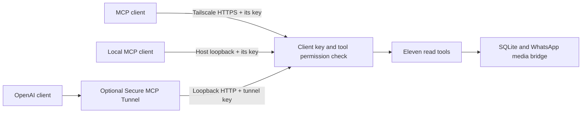

# Private MCP client access

One MCP server checks the same `X-WhatsApp-MCP-Key` header on local HTTP, Tailscale,
and optional OpenAI tunnel routes:



Tailscale controls network reachability. The key controls application access.
Neither a tailnet device nor a loopback caller can read WhatsApp without a valid
key. No Railway public domain, Tailscale Funnel, or public OAuth service is needed.
Keys grant access to all stored conversations through the permitted tools; this
does not implement permissions for individual chats or contacts.

## Issue keys

From this directory:

```bash
python deploy/manage_access.py issue openai-tunnel
python deploy/manage_access.py issue local-client
python deploy/manage_access.py issue desktop-agent --tools list_chats list_messages get_message_context
```

The utility writes `.access/clients.json` containing SHA-256 key digests and
`.access/<client>.key` containing the random 256-bit credential. It prints paths,
never credentials. Files have mode `0600`; the directory has mode `0700`.
The directory is excluded from Git and Docker builds. Keep keys in each client's
secret store. Do not put them in URLs, checked-in configuration or application logs.

## Railway configuration

Every mode requires `WHATSAPP_MCP_CLIENTS`. Tunnel mode also requires a key and
OpenAI runtime credentials. The setup helper can prepare local access with
`--no-tunnel`; see [local Docker setup](docs/LOCAL_DOCKER.md).

Tunnel configuration:

| Variable | Value |
| --- | --- |
| `WHATSAPP_MCP_CLIENTS` | Entire single-line contents of `.access/clients.json` |
| `WHATSAPP_MCP_TUNNEL_KEY` | Secret from `.access/openai-tunnel.key` |

`WHATSAPP_MCP_TUNNEL_ENABLED=false` disables the tunnel. When unset, any provided
tunnel ID, runtime credential, or tunnel key enables tunnel validation, preserving
existing deployments; partial configuration fails rather than silently skipping
the tunnel. `true` explicitly requires it. Invalid values fail startup.

Missing or invalid client policy prevents startup in every mode, including when
the tunnel is disabled. When enabled, the tunnel key must match a client with the full
eleven-tool read grant or the supported ten-tool grant described below; an
explicit text-send grant may accompany either. Validation
runs before the WhatsApp bridge starts; there is no unauthenticated fallback.

The entrypoint uses tunnel-client v0.0.10's static MCP headers for both discovery
and forwarded calls. The key is resolved from the environment inside the tunnel
client, not included in process arguments, and sent only to the configured MCP
origin. The tunnel's control-plane credential stays separate. This key identifies
the whole `openai-tunnel` connection; sessions using that connection share its
identity. The server does not assign a separate key to each end user.

## Connect a local agent

For local Docker Compose, use Streamable HTTP at `http://127.0.0.1:8000/mcp`
and header `X-WhatsApp-MCP-Key` with `.access/local-client.key`.
For Tailscale, use `https://whatsapp-mcp.<tailnet>.ts.net/mcp` and the client's own
key in the same header. The device must have Tailscale
connectivity and permission to reach this service. Replace `<tailnet>` with your
own tailnet's MagicDNS suffix, not another installation's address.

Each MCP client has its own configuration format. It must support a custom HTTP
header or use a local adapter that adds it. A browser address bar cannot supply
this header or act as an MCP client by itself. This is shared server authentication,
not automatic compatibility with every provider's hosted connector. Hosted clients
outside Tailscale need an approved private connector/tunnel path.

## Rotate, restrict or revoke

```bash
python deploy/manage_access.py rotate local-client
python deploy/manage_access.py revoke desktop-agent
```

Apply the updated `clients.json` as `WHATSAPP_MCP_CLIENTS` and redeploy/restart
the service. Rotation invalidates the previous key after restart; update that
client's stored secret. For the tunnel client, update `WHATSAPP_MCP_TUNNEL_KEY`
at the same time. Revocation leaves other client entries enabled. The utility
rejects revoking the final enabled client. It changes local files only; it never
automatically uploads secrets or changes Railway.

`tools` is an optional allowlist in each registry entry; omitted means all eleven
read tools. Discovery shows eleven read tools and, with read-only mode disabled,
`send_message`. The allowlist is enforced before each tool executes. Sending
requires an explicit `send_message` grant and `WHATSAPP_MCP_READ_ONLY=false`.
See [text sending](docs/SENDING.md) for setup and retry behavior.

Audit records contain client ID, safe MCP method/tool name, HTTP status and timing.
They omit keys, tool arguments, message bodies and media paths. A `200` means the
HTTP request was accepted; MCP tool errors may still be inside its response.
`GET /healthz` is an unauthenticated readiness check returning only `{"ok":true}`,
without inspecting the WhatsApp databases. Every MCP HTTP request requires a key.
The HTTP entrypoint supports Streamable HTTP only, avoiding a stdio auth bypass.

## Validate

```bash
python -m unittest discover -s tests -v
whatsapp-mcp-server/.venv/bin/python tests/verify_access.py
whatsapp-mcp-server/.venv/bin/python tests/verify_sdk.py
bash -n deploy/entrypoint.sh
```

Verify each configured route: unauthenticated Tailscale MCP
requests return `401`; a permitted local key can discover and read; a revoked key
returns `401` after restart; OpenAI tunnel discovery and a read tool succeed. Never
paste keys or private WhatsApp results into logs or release notes. Repair and
rollback must preserve the application's authentication boundary.

`get_message_identity` uses the same archive read boundary. The tunnel also
accepts an explicit grant of the ten other read tools; that policy denies
`get_message_identity` until it is included in the allowlist. Policies omitting
`tools` grant all read tools. Startup never rewrites allowlists or credentials.

